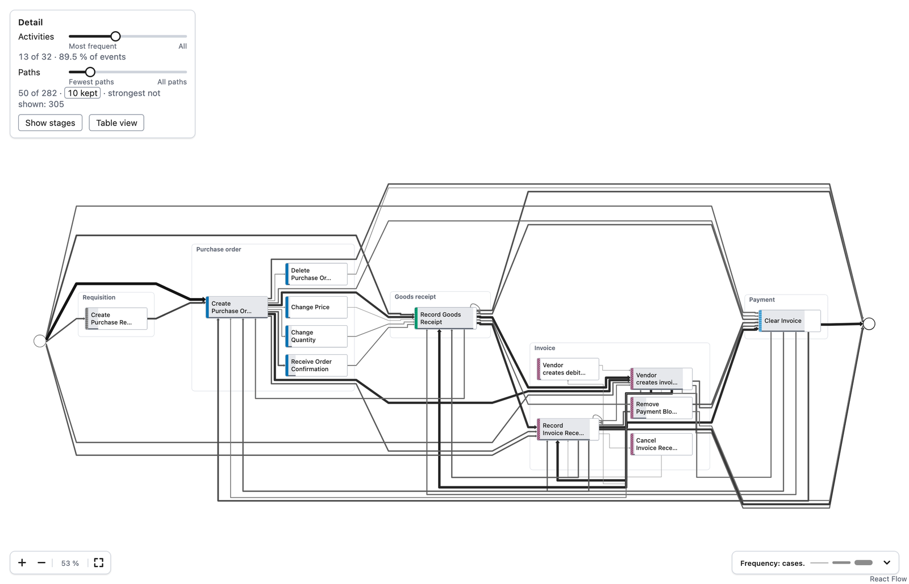

# wise-flow

Process-flow visualisation for applications that supply activities, stages,
directly-follows counts and metrics. Flow provides a headless TypeScript core,
React and Canvas renderers, BPMN import/export and a bpmn-js viewer/modeler.
It handles layout, abstraction, overlays, selection and drawing; the host owns
data, analysis, persistence and the meaning of actions.

## Install

Supported development and CI runtimes: Node 22 or 24 LTS, npm. React components
require React and React DOM 18 or later; the packed consumer is tested with the
React 18.3.1 and 19.2.8. CI covers Node 22/React 18 with Chromium and Node 24/React 19 with Chromium, Firefox and WebKit. The package is ESM with TypeScript
declarations; CommonJS `require()` is not a supported entry point.

Version **0.3.5 is a local packaging candidate, not a published release**. Given
a supplied tarball, place it in your application's `vendor/` directory and run:

```sh
npm install --save-exact ./vendor/wise-flow-0.3.5.tgz react react-dom
```

Commit the tarball and application lockfile for a standalone `npm ci`. No sibling
checkout, source alias, stub, or postinstall build is needed. Check its SHA256
against the supplied `.sha256` and `.provenance.json` files. A future published
release can replace the file dependency with an exact registry version.
The package is named `wise-flow`; a host that installed it under its former
scoped name changes its dependency entry and import specifiers as `docs/API.md`
("Package name") says.

To produce and verify the tarball from this checkout:

```sh
npm ci
npx playwright install chromium
npm run test:package
```

This rebuilds with `npm pack`, installs the actual tarball into a temporary
consumer outside the checkout, and checks Node ESM, TypeScript NodeNext,
production browser bundling, Map, BPMN viewer/modeler, CSS, fonts and the ELK
worker. Outputs are in `artifacts/`: tarball, SHA256, source patch and provenance.
The provenance distinguishes the base commit from any uncommitted modifications;
a version number alone does not identify an unpublished candidate.

## Entry points

| Import | Purpose |
| --- | --- |
| `wise-flow` | Headless graph model, aggregation, abstraction, layout, scales, overlays, selection, paths, filters, lanes, SVG export |
| `wise-flow/react` | `ProcessMap`, `BpmnView`, Canvas wrapper, table alternative, timeline and controls |
| `wise-flow/bpmn` | BPMN-lite, XML import/export with diagram interchange, mapping and `BpmnView` |
| `wise-flow/canvas` | Scene preparation, Canvas renderer, PNG export |
| `wise-flow/tokens.css` | Theme variables |
| `wise-flow/react-flow.css` | React Flow's required base styles, for use with `style.unlayered.css` |
| `wise-flow/style.css` | Flow component styles and React Flow's base styles, in the cascade layer `wf` |
| `wise-flow/style.unlayered.css` | Flow component styles without a layer, for pages with an unlayered reset |
| `wise-flow/bpmn.css` | All required bpmn-js styles and font references |
| `wise-flow/bpmn/assets/*` | Copied BPMN asset tree, including `bpmn-font/font/bpmn.woff2` |
| `wise-flow/elk-worker.min.js` | Optional ELK worker asset |
| `wise-flow/dagre-worker.min.js` | Optional Dagre worker asset (layout fallback off the calling thread) |

The root entry does not load React or require a DOM. The package still installs
renderer dependencies and React peers; it is not a separate minimal core package.
`wise-flow/bpmn` retains its React component re-export for compatibility.

## Headless example

```js
import { layout, toSVG } from 'wise-flow';

const graph = {
  nodes: [
    { id: 'receive', kind: 'activity', label: 'Receive' },
    { id: 'complete', kind: 'activity', label: 'Complete' },
  ],
  edges: [{ id: 'flow', kind: 'follows', source: 'receive', target: 'complete' }],
};
const positions = await layout(graph);
const svg = toSVG({ graph, positions, title: 'Example process' });
```

Exports draw the `print` theme unless given another (`theme: 'default'` draws
the screen's look, as exports did before), and keep their texts at 7 pt or
more at the width a figure is printed at (`widthMm`): where a card cannot show
its name, it is numbered and the names are listed beside the map.

ELK runs in-process by default, with Dagre fallback. In a browser, pass the
workers: in-process ELK holds the page while it runs and cannot be
interrupted (a layout nobody waits for any more runs to its end, and its
timeout cannot cut it short), and without a Dagre worker the fallback runs on
the calling thread only up to 500 nodes plus edges. For browser workers in Vite:

```ts
import elkWorkerUrl from 'wise-flow/elk-worker.min.js?url';
import dagreWorkerUrl from 'wise-flow/dagre-worker.min.js?url';
const positions = await layout(graph, { elkWorkerUrl, dagreWorkerUrl, signal });
```

Other bundlers can copy the exported workers and pass their served URLs. Serve
them from an origin permitted by your application's worker policy. An aborted,
timed-out or replaced layout terminates its worker.

## React and BPMN

Import the styles once in your application's entry file. Their package exports
work with normal bundler resolution; no dependency-directory traversal is needed.

```tsx
import 'wise-flow/bpmn.css';
import 'wise-flow/tokens.css';
import 'wise-flow/style.css'; // includes React Flow's base styles
// On a page with an unlayered reset (Tailwind 3's preflight), instead:
// import 'wise-flow/react-flow.css'; import 'wise-flow/style.unlayered.css';
import { ProcessMap, BpmnView } from 'wise-flow/react';

// Supply graph from the host and XML from an import or exportBpmn().
<>
  <div style={{ height: 500 }}>
    <ProcessMap graph={graph} onSelect={selection => console.log(selection)} />
  </div>
  <div style={{ height: 500 }}>
    <BpmnView xml={xml} mode="view" />
  </div>
</>
```

A host restyles the interactive map and its panels with selectors of the
`data-wf-part`, `data-wf-kind` and `data-wf-state` attributes; the parts, kinds
and states are listed in [docs/styling-contract.json](docs/styling-contract.json)
and described under "Styling contract" in the [API](docs/API.md).

`bpmn.css` includes diagram-js, bpmn-js and icon font CSS. Its relative font URLs
are preserved in the tarball; keep that tree together if copying assets manually.
Keep the bpmn.io watermark fully visible, unobscured and linked. See
[licensing](docs/LICENSING.md) and [third-party notices](THIRD_PARTY_NOTICES.md).

```ts
import { liteFromStages, exportBpmn, importBpmn } from 'wise-flow/bpmn';
const model = liteFromStages({
  stages: [{ id: 'work', label: 'Work', activities: ['receive', 'complete'] }],
});
const { xml } = await exportBpmn(model);
const { graph, mapping } = await importBpmn(xml);
```

See the [API](docs/API.md), [architecture](docs/ARCHITECTURE.md) and Storybook
stories for overlays, shared layouts, actions, lanes, views and Canvas rendering.

## From an event log

Flow draws what the host counted. [examples/event-log](examples/event-log/README.md)
turns a CSV event log (a case, an activity and a time per row) into a
`FlowGraph`, shows it as an interactive map and draws it as a figure, step by
step with the BPI Challenge 2019 purchase-to-pay log:



## Limits

- Flow displays supplied metrics. It does not perform conformance checking,
  determine root causes, calculate a business roadmap or persist user actions.
- BPMN-lite is a visual model generated from stages or directly-follows data;
  it is not proof of executable BPMN semantics. Import/export maps supported
  elements and returns warnings; do not assume arbitrary models round-trip losslessly.
- Components require a browser and a container with nonzero dimensions. Canvas
  drawing/PNG export needs Canvas APIs; Node users must supply a compatible canvas.
- Dense graphs can produce small or overlapping labels. Abstraction, zoom and
  the table alternative help inspection; screenshots are regression checks,
  not a guarantee of readability for every input.
- Screenshot baselines are platform-specific. Linux CI asserts the committed
  Linux files; macOS results cannot establish Linux pixel equivalence.
- The package is under a noncommercial licence. Public source availability does
  not grant unrestricted commercial or organisational use.

## Develop

```sh
npm ci
npm run check
npm run build
npm run test:package
npm run storybook
npm run test:visual
```

Unit tests use public fixtures and synthetic graphs. Rebuilding the optional
BPIC fixture requires an external CSV; ordinary checks need no private dataset
or model server. See [testing](tests/README.md) for separate screenshot approval,
and [contributing](CONTRIBUTING.md). Roadmap and checkpoint documents describe
historical milestones or proposals, not current release guarantees.

## Quality and next steps

See the [CI and release guide](docs/CI.md), [feature map](docs/FEATURE_MAP.md),
[ordered roadmap](docs/ROADMAP.md) and [candidate verification](docs/VERIFICATION.md).
CI enforces unit/component coverage, headless boundaries, installed-consumer
compatibility, browser accessibility, strict Linux screenshots and artifact sizes.
The next product work prioritizes context integrity and observed variants before
adding more diagram types. A graph route is not proof of an observed trace.

## Licence

Flow remains under [PolyForm Noncommercial 1.0.0](LICENSE). The licence defines
permitted purposes, notices and distribution conditions, including provisions
for specified noncommercial organisations. Commercial uses outside those grants
need separate permission from the copyright holder. No alternate commercial
licence is bundled or promised. Dependency licences remain separate; see
[licensing notes](docs/LICENSING.md).
