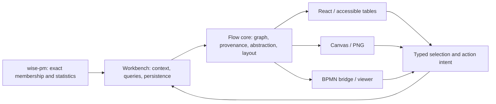

# Architecture

## 1. Layers

```
┌────────────────────────────────────────────────────────────┐
│ react/   <ProcessMap/> <TableAlternative/> <TraceTimeline/> │
│          <BpmnView/> <ViewSwitcher/> <ContextMenu/>          │
│          <PathList/> <FilterChips/> <CanvasMap/> <Legend/>   │
│          <ZoomControl/> · panel primitives · fit             │
│          useMapController · map-pointer · map-actions ·      │
│          map-elements · nodes · edges · marks · theme        │
│          hooks: useFlowGraph, useStableLayout, useOverlays   │
├──────────────────────────┬─────────────────────────────────┤
│ canvas/  scene · draw ·  │ bpmn/  lite · layout · export ·   │
│          renderer · png  │        import · ids · vocabulary · │
│          · tokens        │        scene · projection ·        │
│                          │        viewer · bpmn-js · moddle   │
├──────────────────────────┴─────────────────────────────────┤
│ core/    model · aggregate · layout · lanes · routing ·     │
│          courses · scene · overlays · overlay-geometry ·    │
│          overlay-marks · element-marks · mark-svg · figure ·│
│          text · tokens · theme · style · hit · export ·     │
│          views · selection · map-controller · actions ·     │
│          paths · filters · format · metrics · strings ·     │
│          viewport · detail                                  │
└────────────────────────────────────────────────────────────┘
```

Dependencies point downwards only. `core` has no DOM and no React; it is
tested in Node. Renderers translate the core's scene description into
React Flow elements, Canvas draw calls or bpmn-js overlays.

### 1.1 Module map

Each row is one module that owns a decision; the renderers are adapters that
read what it resolves and do not decide it again.

| Module | Interface | Owns | Read by |
| --- | --- | --- | --- |
| Scene (`core/scene.ts`) | `buildScene(graph, positions, options)` → `FlowScene` | activity references, lane bands, scales, the overlays to show in canonical order with the follows self-loops, level-of-detail rules, overlay geometry, the marks and the legend, resolved once in a theme and colour scheme (§2.4, §2.6) | `toSVG`, `prepareScene` (Canvas, `toPNG`), `ProcessMap`, `BpmnView` (`bpmn/scene.ts` over the registry's boxes) |
| Overlay marks (`core/overlay-marks.ts`) | `FlowScene.marks`, `OverlayMark` | per placed overlay: box or path, fill, stroke, dash, arrowhead, texts, layer, zoom threshold, whether it is on the map (§2.5) | SVG export, Canvas drawing, React nodes and `OverlayLayer`, BPMN projection |
| Node, edge and group marks (`core/element-marks.ts`) | `FlowScene.nodeMarks`, `FlowScene.edgeMarks`, `FlowScene.groupMarks` | outline, fill, border, band, texts and their level of detail; an activity's or a stage's card: its name on up to two lines, its number line (cases and their share of the log's), its frequency cue and whether it is out of scope; edge route, colour, dash, count label; a group's tint, outline, band sides and rule, title and chip anchor (§2.5) | SVG export, Canvas drawing, React node, edge and group components |
| Path courses (`core/courses.ts`) | `pathCourses(graph, positions, { width, bands })` → `PathCourses` | the course of a path against the reading direction (its own line below the flow it returns over, entering its target from below) and of two opposite paths (side by side), and where their labels go (§2.5) | `buildScene`, whose positions and edge marks carry them to every renderer, the hit index and the culling |
| Text measure (`core/text.ts`) | `TextMeasure`, `estimateTextWidth`, `truncateText`, `wrapText`; `buildScene(…, { textMeasure })`; `canvasTextMeasure` (Canvas) | how wide a text is, where it is shortened and how it wraps: node labels, chip texts and their boxes, activity names and boxes, the legend's texts, the figure's note and activity key, measured once when the scene is built (§2.5) | the mark builders, the overlay geometry, the legend layout and the figure frame; the renderers write the fitted texts |
| Theme (`core/theme.ts`, `checkTheme` in `core/style.ts`) | `Theme`, `defaultTheme`, `printTheme`, `resolveTheme`, `themeColors`, `checkTheme`; `buildScene(…, { theme, scheme })` | what the marks are drawn in: colour roles with the dark scheme's changes, the data palettes and the pattern twins' order and look, fonts, text, radius, stroke, opacity and spacing tables, the place of the frequency cue, density, the smallest text and stroke, rules (none in the presets); the presets (`defaultTheme` is the token table, `printTheme` its `printTokens` over it); a setting as changes over a preset over the host's CSS variables; the CSS variable of every part; what of a theme falls short (§2.4) | the scene and its mark builders and scales; through the scene the SVG export, Canvas drawing, PNG export and React components; `useFlowTheme` (React), which reads the variables |
| Rules (`core/rules.ts`) | `ThemeRule`, `stateStyle`, `markInState`; `checkTheme` | which rules of a theme apply (the others reported), what they set on an element by part, kind, tag and state in their order with a state's rules last, and the paints, widths, dashes, radii and opacities they resolve to; for the interactive states, what the maps draw over a mark (§2.4) | the node, edge, group and overlay mark builders; `drawScene` (Canvas); the React map's elements |
| Edge budget (`core/edge-budget.ts`) | `budgetEdges(scene, budget, protection, inView)` → `EdgeSelection`; `edgeBudgetAdapter(clock)` (internal) | which edges in view a budget draws: protected edges (an overlay mark on them, selected, at the keyboard position, on a highlighted path), then weight, then id; or exactly the edges a map reported (`ShownEdges`); the adaptive budget's step, moved by the timed frames of gestures and only at rest (§4) | `drawScene` and `CanvasRenderer` (Canvas, `toPNG`), `useFlowElements` (React Flow), `toSVG` |
| Mark SVG (`core/mark-svg.ts`) | `markSvg`, `svgMarkup` | the SVG elements of a mark | SVG export, React map, BPMN view |
| Legend and figure frame (`core/figure.ts`) | `FlowScene.legend` (`legendOfScene`), `LegendRow`, `legendLayout`, `figureFrame`, `figureCaption` | the legend's typed rows from what the scene draws (the measure and its unit, the scales titled by metric and unit, a key per kind of mark drawn), their heights and texts at the export's width, the exported figure's frame, its caption line and the note on withheld edges in it (§2.6) | `toSVG`, `toPNG`, Canvas `drawLegend`, `<Legend/>` |
| Fitted view (`core/viewport.ts`) | `fitViewport(bounds, area, { insets, padding })`, `panelInsets(panels, area, bounds)` | the view that shows a map whole inside its area less insets, and the insets that keep it clear of the panels over it (each panel kept clear across or along the area, whichever leaves the larger zoom) | `ProcessMap` (React Flow), `CanvasRenderer.fit` and `CanvasMap`, `BpmnView` |
| Selection by detail (`core/detail.ts`, through `abstract` in `core/aggregate.ts`) | `abstract(graph, { activityDetail, pathDetail, marks })` → `FlowGraph` with `meta.shown`; `ANCHOR_TAG`, `INDIRECT_TAG` | which activities and paths two detail shares show: activities by rank, paths by their rank in the whole graph, each shown activity's anchors (its strongest path from and to a more frequent node, or the way through rarer ones whose rarest is the most frequent), indirect paths for stretches through activities not shown, the elements of protected marks, and what is shown and what of the marks is not (§2.2) | `<ProcessMap/>` through `useFlowGraph`, `buildViews`, `liteFromGraph`; hosts |
| Statements of the detail shares (`core/detail-statement.ts`) | `detailStatement(graph, { locale, marks, labelOf })`, `detailNotes(base, shown, options)` | what a graph abstracted by `abstract` shows, in words: the short and full statements beside the detail sliders (activities and their share of events; paths by frequency, kept, the strongest not shown), the marks not shown, the elements shown for a protected deviation; what the tooltips of the shown elements add (§2.2) | `<AbstractionControls/>` through `<ProcessMap/>`, `figureCaption`; hosts |
| Metric registry (`core/metrics.ts`) | `metricRegistry`, `formatMetricValue`, `elementMetric`, `metricLabelOf`, `channelTitle` | for each metric its name, unit and number format in English and German, and how a lower bound and a mean of merged values read (§2.2, §2.6) | the legend, the node and edge marks, the descriptions, `<TableAlternative/>`, `<PathList/>` |
| Design tokens (`core/tokens.ts`) | `designTokens` and its parts, `patternTwin`, `tokenVariables` | colours, palettes, fonts, node sizes, the arrowhead rule, pattern twins, and every size, radius, stroke, dash, text size and weight, opacity, spacing step and z-order by role; `tokens.css` is generated from it and checked against it (§2.4) | marks, SVG export, Canvas drawing and `readTokens`, PNG export, React components, `tokens.css` and through it the stylesheet |
| Graph index and positions (`core/model.ts`, `core/layout.ts`) | `indexGraph`, `createPositions` | lookups, adjacency, group ancestors, nested members, labels; positions whose bounds always match their contents (§2.1, §2.3) | selection, filters, paths, lanes, layout, every renderer |
| Layout cache (`core/layout.ts`, `core/layout-key.ts`) | `layout`, `createLayoutScope`, `cacheKey`, `clearLayoutCache`, `signal` | layouts keyed by their own inputs, bounded per scope, released on `dispose`; a layout runs while somebody waits for it; ELK and Dagre workers started on demand and terminated when their layout is aborted, timed out or replaced (§2.3) | `ProcessMap`, `useStableLayout`, `layoutBpmn` |
| Provisional arrangement (`core/provisional.ts`) | `provisionalLayout`, `reusePositions` (internal) | what a map shows until its layout arrives: a linear-time layered arrangement, or earlier positions of the nodes still present (§2.3) | `useStableLayout` (`ProcessMap`) |
| Lane model (`core/lanes.ts`) | `laneModel`, `stackLanes`, `spanLanes`, `laneRoutes`, `laneBands` | which groups are lanes, each node's lane, stacking, pool and parent boxes, edges across lanes (§2.8) | map bands (`ProcessMap`, Canvas, SVG), `layoutBpmn` |
| Map controller (`core/map-controller.ts`) | `mapStep(state, event, context)` → next state, sentence, intents | selection, focus of paths, hover, keyboard position, actions menu and the live region's sentence (§2.8) | `useMapController` (`ProcessMap`, React Flow and Canvas pointer input via `map-pointer.ts`), `<ContextMenu/>`, `<TableAlternative/>`, `BpmnView` |
| Id resolver (`bpmn/ids.ts`) | `createIdResolver`, `renameToActivities` | which FlowGraph, BPMN and activity ids name one element (§5) | `importBpmn`, `exportBpmn`, `applyMapping`, `BpmnView` |
| Viewer seam (`bpmn/viewer.ts`, `bpmn/bpmn-js.ts`, `bpmn/projection.ts`) | `BpmnViewer`, `projectMarks`, `selectionOf`, `hoverOf` | everything `BpmnView` asks of bpmn-js; where each mark goes on the diagram (§5) | `BpmnView` with the bpmn-js adapter; the component tests with an in-memory viewer |

### 1.2 Checked boundaries

`npm run check:architecture` (`scripts/check-architecture.mjs`, with negative
examples in `tests/tooling/architecture.test.mjs`) enforces:

- The core imports only the core and the reviewed packages (`@dagrejs/dagre`,
  `d3-scale`, `elkjs`, `rbush`); no React, no DOM, no renderer.
- The scene and the map controller stay inside the core: `core/scene.ts` and
  `core/map-controller.ts` exist there, and no module of `src/index.ts`,
  `react/`, `canvas/` or `bpmn/` declares a name they export, so no renderer
  builds its own scene or transitions.
- Adapters do not import each other. The Canvas renderer and the BPMN bridge
  never import one another; the React layer reaches the Canvas renderer only
  from `CanvasMap.tsx` and `map-elements.ts`, and the BPMN bridge only from
  `BpmnView.tsx`; the bridge reaches React only where its entry point
  re-exports `BpmnView`. React and React Flow are loaded only in `react/`,
  bpmn-js and bpmn-moddle only in `bpmn/`.
- The BPMN bridge's modules other than its entry point load neither React nor
  bpmn-js eagerly; Node tests reach the bridge through `bpmn/headless.ts`.
- Stories take their maps from `stories/maps.tsx`, which gives them a fixed
  edge budget, and no story or Storybook file asks for an adaptive one. A
  component of the React adapter that renders a map counts as a map.
- Outside the core, a name the core entry point provides is imported from the
  entry point, whose names `scripts/core-exports.json` lists; the deprecated
  names of every entry point are listed in [API](API.md#deprecated-names), the
  removed ones under [next version](API.md#removed-in-the-next-version).

## 2. Core

### 2.1 Model
`FlowGraph { nodes, edges, groups, overlays, meta }`, the JSON of
`GET /runs/{id}/flow`. Nodes: `activity`, `stage`, `gateway` (xor/and/or by
tag), `event` (start/end by tag), `note`. Node ids are the caller's stable
ids (canonical activity ids in the workbench). Edges: `follows`
(directly-follows with `count`, `cases`, `share`, `medianLagHours`,
`violationShare`), `constraint` (arc between two nodes with a payload),
`flow` (BPMN sequence flow). Groups: `lane`, `stage`, `pool`, nested through
`parent`. Every element carries a `metrics` record (numbers) and `tags`
(strings) that scales and overlays read. `validateGraph` reports duplicate
ids, dangling edges and unknown targets; `validateGateways` reports parallel
gateways that are not paired (§5).

### 2.2 Aggregation
`abstract(graph, { minEdgeShare, minNodeShare, keepConnected, collapse })`
removes activities and follows edges whose strength (count or cases
relative to the strongest element) is below the thresholds, collapses stage
groups into stage nodes (semantic zoom) and restores connectivity: first a
maximum spanning forest over the strongest direct edges between the kept
nodes, then the cheapest paths of the original graph through removed nodes,
then one edge per activity that lost all incoming or all outgoing paths.
Re-added elements are tagged `reconnected` and drawn dashed. A collapsed
stage takes the maximum of its activities' `cases` and `share` and weighted
means of other metrics; the graph holds no case sets, so these are not the
stage's own numbers. The result keeps the values and marks them in
`metricBasis` (`atLeast`, `mean`), and every surface reads them with the
metric registry: "at least 211,379", "lag, mean of medians". Merged parallel
paths are marked the same way; summed counts stay exact. The thresholded
part is monotone in the thresholds; the reconnection is bounded (paths
between components plus one edge per open need) but not a global optimum,
so the total element count may differ by one re-added edge between
neighbouring thresholds. `diff(a, b)` returns a graph with `b`'s metrics,
`a_<metric>` and `delta_<metric>`, one-sided elements tagged. In such a
comparison (`meta.diff`) an element's strength is the larger of its relative
strength on side b and on side a (`a_<metric>`), each relative to the
strongest element of its side, for thresholds and detail shares alike; an
element neither side measured keeps strength 1.

**Protected marks.** A mark (overlay) with `protected: true` keeps the
element it sits on with thresholds and at every detail share: an activity, a
path with both its ends, both activities of an arc. `abstract` reads the
graph's overlays and the `marks` given beside it (collapsed with the graph,
so a mark moves to the stage holding its element); `meta.shown` names the
marks whose element is not shown and the elements shown only for a
protected mark. `ProcessMap` merges its `overlays` prop into the graph
before it abstracts, so marks inside and beside the graph behave alike in
the DOM map and the Canvas map; `buildViews` passes its views' marks.

**Detail shares** (`core/detail.ts`). Given `activityDetail` or
`pathDetail`, `abstract` selects by detail instead of thresholds. Nodes are
ranked once: events and gateways first by id, then activities by strength
(cases), events, id. The activity share shows a prefix of the measured
activities in that rank, rounded up, at least one, extended over a tie of
cases and events. Measured paths (follows edges) are ranked by strength, then
id, over the whole graph (a self-loop's strength not capped at 1, so that
paths rank by count); the paths share shows the paths whose rank lies within
it and whose ends are shown. What no metric measured, as thresholds have it
(an activity or note without one, a path without one, a flow edge), is shown
at every share, a path when both its ends are.
Every node has an anchoring way in (from a start or a node of lower rank
that a start reaches) and out (to an end or a node of lower rank that
reaches an end; the searches pass only such nodes): its strongest direct path, else
the way through nodes of higher rank that minimises the highest rank on it,
then the steps, then path ids (a search keyed by the highest rank passed
finds that rank; a breadth-first search through nodes of no higher rank, its
paths in id order, then the way). For
each shown activity, and for each shown node where such a way stops, the
ways are followed through anchoring nodes that are not shown to the first
shown one; the walk is split at shown nodes into paths of the graph (shown,
tagged `anchor` outside the paths share) and stretches through hidden
nodes, each one `indirect` edge without metrics, named by its way (one
stretch, one edge). Following the anchoring nodes strictly lowers the rank,
and a node a start reaches has a way in through such nodes (the last node
before it on any way from a start that is not rarer than it is one), so
every shown activity on a way in the graph reaches a start and an end by
induction over the rank. The anchors depend on the graph only, the
shown set grows with either share, and a walk split at more shown nodes
keeps every path it had: so neither share removes an element as it grows,
except an indirect edge whose activities come into view.

**What the shares show, in words** (`core/detail-statement.ts`).
`abstract` records in `meta.shown` the sliders' positions (the numbers of
activities that end a tie, the measured paths, and where the shares or the
thresholds stand), the paths shown by frequency, the weakest path shown and
the events shown. `detailStatement` turns `meta.shown` into the statements of
the detail panel and of an export's caption; `detailNotes`, given the graph
before and after the shares, into what the tooltips of the shown elements
add (passages on paths not shown, what a kept path keeps, what an indirect
path passes, an element shown for a protected deviation). Both read only
the core's model and strings.

**Joining components.** An edge costs a reconnecting path `1 + (1 −
strength)`: 1 for the edge, so every removed node on a path adds at least 1
(a path through k removed nodes has k + 1 edges), plus its weakness, at
most 1 more for an edge of strength 0. Constraint and flow edges have
strength 1; self-loops never join anything. Node strength does not enter
the cost. It only picks the component the joins start from: the one whose
activities' strengths sum highest (events and gateways count 0; a tie goes
to the component with the smallest node id). First the cheapest direct
edges between kept nodes join components, a minimum spanning forest by
cost, then edge id. Then every join takes the component nearest to all
that is joined so far, through its cheapest path, and re-adds the removed
nodes on it; each other component a re-added node touches joins at once
through its cheapest direct edge (cost, then edge id). The objective holds
per join, not for the total: which of two equally near components joins
first can change what later joins cost.

Up to 0.3.5 every join searched again from the whole joined component.
Equally near nodes left that search in the order they had entered it, and a
node kept the first path that reached it. The search took the joined nodes
in an order that followed the input order and each node's edges by cost,
then edge id, so on some graphs the choice depended on the input order and
on others it was fixed by the edge ids, and the id rule below may then
choose differently. Now one search grows the joined component and continues
from each newly joined part at distance 0; it searches a node again only
when a newly joined part is nearer to it. On the cyclic and many-component
graphs of the tests the work grows like (nodes + edges) · log nodes; a
removed node near many components that are joined one after another, each
slightly nearer to it, is searched once per such join, so on such graphs the
work can still grow with the number of joins times the number of edges, as
it did on every graph up to 0.3.5. Ties are broken by id: of equally near
nodes of other components the one with the smallest id is joined first, a
node on equally cheap paths is entered by the edge with the smallest id,
and a touched component joins by the smallest id among its cheapest direct
edges. With unique ids the result therefore does not
depend on the input order. Each join costs what the search per join of
0.3.5 would have found; where it broke a tie differently, later joins and
so the total may differ in either direction. The committed fixtures are
unchanged at every threshold.

### 2.3 Layout
`layout(graph, options)` runs ELK layered: in a Web Worker when the
application passes `elkWorkerUrl` (the URL of `elkjs/lib/elk-worker.min.js`),
in-process otherwise (Node, tests). Stage groups become compound nodes with
their order along the flow direction enforced through ELK partitions; lanes
are compound nodes as well. Dagre is the fallback on failure or timeout: in a
Web Worker with `dagreWorkerUrl` (the package's `dagre-worker.min.js`, which
runs the compiled `dagreJob` of the layout module, so both places give the same
positions), otherwise on the calling thread only up to `fallbackLimit` nodes
plus edges; above it the layout fails with `LayoutUnavailableError` and the
map keeps its provisional arrangement. **Stopping**: each layout is a job that
runs while somebody waits for it; a caller's `signal`, a newer request to the
same scope and `timeoutMs` (per engine run) stop waiting, and a job nobody
waits for terminates its worker (one worker per running job, so no other
layout is affected) and reads nothing it sends afterwards. In-process ELK
cannot be interrupted; its result is discarded.
Elements are sorted by id before the engine runs, so positions are
deterministic. `Positions` holds absolute boxes for nodes and groups, edge
routes, bounds, engine and direction. **Stable layout**: `layoutUnion(scenes)`
lays out the union graph once and returns positions that every scene
filters (`filterPositions`), so compared maps do not jump. **Cache**: the
layout module owns it. A caller key (`cacheKey`) keeps positions in a shared
cache until its owner forgets the key. Without one, a layout scope
(`createLayoutScope`) keys each layout by its inputs (nodes with resolved
sizes, edges, groups, options), keeps a bounded number and releases them on
`dispose`, so a changed graph is always laid out anew. The module starts
workers on demand and terminates each once no scope and no running layout
uses it; a scope keeps one idle worker per URL. The map lays out the *abstracted* graph (not the full
directly-follows graph), because hundreds of weak edges degrade layered
layouts; each map's scope makes returning to a previous abstraction level free.
**First scene**: until a layout arrives, `useStableLayout` returns a finished
layout of the same inputs from its scope, or `reusePositions` (the earlier
positions of the nodes still present, new nodes at the offset a provisional
arrangement gives them from a placed neighbour), or `provisionalLayout`:
longest-path ranks along the flow inside each group and on the map, one
barycentre pass per rank, each group one box in its parent's rank (top-level
stages in their order), straight edges; its steps are linear in nodes plus
edges. These positions carry `engine: "provisional"`.

### 2.4 Style
`buildScales` builds d3 scales from metric ranges: edge width ← count
(square root from 0 to the strongest path of the graph before abstraction,
which `abstract` records in `meta.model.pathMax`, or to an upper end the host
gives, never under the thinnest line; so a path keeps its width when the
sliders move), edge and node colour ← a chosen metric on colour-blind-safe
sequential (single hue), diverging (purple–orange) and categorical
(Okabe–Ito without orange and vermilion) palettes. The default style colours
a path by its cases too, on the same square-root scale along the theme's grey
`neutral` ramp (darker with more cases in the light scheme, brighter in the
dark), so the main flow is the most visible line; `shortfallStyle` colours it
by the expectation shortfall share instead. Deviations (badges, chips, arcs,
their labels, tints, constraint edges) are the one hue, the theme's
`accent`; categorical
keys take colours with their pattern twins in stage order (the host's stage
list, the unfiltered graph's group order that `abstract` records, then the
graph's), each from its hashed colour to the next free one, so no two stages
share a swatch until the palette is used up and patterns tell them apart
after that; paths count cases like activities (transitions where a graph
gives no cases), and a path without a value is drawn thin in the line colour
and labelled "–"; text on coloured fills
uses an ink with contrast ≥ 4.5 : 1. Level-of-detail rules say from which
zoom labels, edge labels, badges, arcs, chips, hatching and self-loops
appear; thresholds tighten with the number of nodes. Colours, palettes, the
font stack, default node sizes, mark sizes, the arrowhead rule and the
pattern twins live in one token table (`tokens.ts`), and so does every
size, radius, stroke width, dash, text size and weight, opacity, spacing step
and z-order the library draws, each under a role name (activity name, path
label, group outline, reconnected dash, dimmed opacity, …). The SVG export,
the marks, the Canvas drawing, the PNG export and the React components read
the table for their roles; the Canvas map follows the theme a page resolves
for colours and the font (below). `npm run tokens` generates `tokens.css`
from the table: the colours, the node sizes and the roles the stylesheet
uses, as CSS variables, which the stylesheet reads. Tooling tests fail when
`tokens.css` differs from the table and when one of its variables is read
nowhere. Where two renderers
draw a role differently, the table holds both values under two names.

**Theme.** Appearance is scene data. A theme (`theme.ts`) holds the colour
roles of the light scheme and what the dark scheme changes, the data palettes
(`neutral`, `shortfall`, `performance`, `diverging`, `categorical`), the fonts,
the text, radius, stroke and spacing tables, a density and a list of rules
(none in either preset); `defaultTheme` is the token table. `buildScene` takes
`{ theme, scheme }` and resolves the marks in it once: outline widths, dashes,
radii and text styles from the theme's tables, data colours through its
palettes (the scales and overlay colours read them, so no fixed hex value of
the palettes reaches a mark), and paints by role, whose colours in the scheme
the scene carries (`colors`). Every renderer draws from the marks, so a theme
and the dark scheme reach the interactive map, the Canvas map, the SVG export
and the PNG export alike: the Canvas drawing and the exports take their
colours and font from the scene unless given others, and the interactive map
paints the roles with the CSS variables of `tokens.css`, whose dark blocks
hold the dark scheme's values. In the dark scheme the marks take the scheme's
neutral colour, accent and palettes (`darkPalette` over `palette`: the path
ramp runs dim to bright). A browser test draws committed fixtures in a
second theme, in the dark scheme and under a host's CSS variables through all
four and compares what they drew.

**Presets, settings and the page.** The presets are `default` (light and
dark) and `print` (white paper, no tints, an opaque pattern on every
categorical colour, ramps that start at 3 : 1 on the paper, no text under
7 pt nor stroke under 0.75 pt in its tables, no dark scheme). A host
sets a theme as a preset's name or as changes over a preset; `resolveTheme`
puts the setting over what the host wrote as CSS variables over the preset,
and keeps only literal colours, so every paint of an export is a literal. The
exports draw the `default` preset in the light scheme unless told otherwise
and never read the page. Every part of a theme has one `--wf-*` variable
(`themeVariables`, `themeFromVariables`); in a page, `useFlowTheme` (React)
reads them on the map's element (set there or inherited; given a `theme`, the
map writes its own there and sets them aside while it reads), leaves out what `tokens.css` sets, turns
any CSS colour into a literal (one pixel of a canvas), takes the scheme
`tokens.css` draws in, and follows changes of attributes and of the system's
scheme. Colours read in the dark scheme are the `dark` roles, so an export in
the light scheme does not inherit them. The map builds its scene from what
of the theme the marks are built from (`markedThemeKey`), so a change of a
colour repaints the DOM map (through the variables) and the Canvas map (its
tokens) without a new scene; a change of a size builds the scene once;
neither lays out again. The default text measure is in the theme's font,
so a change of the font builds the scene once. Given a `theme`, the map writes the
theme's variables that the stylesheet reads on its element, and gives its
pattern twins the theme's ink and pattern look. `checkTheme`
reports contrasts (a translucent colour over its ground), the path ramp,
sizes and non-literal colours as data; the components log it in development.

**Rules.** A theme's `rules` (`rules.ts`) restyle elements by part (node,
edge, group, mark), kind, tag and state within a closed set of properties
(fill, fill opacity, stroke, stroke weight, dash, radius, opacity, the size,
weight and colour of each text role, the place of the frequency cue); the
type has no field for shapes, pattern twins, arrowheads, shadows, gradients or
geometry. The mark builders apply them when the scene is built: the rules
without a state in their order, then those of the states the element is in
there (`outOfScope`, `reconnected`), so the marks, and through them the
exports, carry the result; a colour role is drawn in the scheme's colour, a
paint a rule sets is a literal in the mark. `stateStyle` gives what the rules
of the interactive states (`selected`, `focused`, `hovered`, `dimmed`) set
over a mark; the DOM map and the Canvas map both draw a state from it, and
where it gives nothing they draw the state as by default. A rule `checkTheme`
reports (an unknown entry or a value out of range) changes nothing; an
opacity is clamped to 0.2 to 1.

### 2.5 Overlays
An overlay is data, not drawing: `{ kind, target, payload }` where kind is
`badge | arc | hatch | tint | chip | selfLoop` and target is a node, edge,
group id or `__map`. Presets map a constraint description (presence,
singularity, exclusion, lag, precedence, balance / metric, applicability)
and its statistics to overlays with formatted readings. Renderers draw
overlays; the core computes their geometry (badges as pills in a row wholly
above the node, cubic arcs above the map and reverse arcs below it, each at the
height or on the side that crosses the fewest other activities, self-loops at
the corner, a group's chips in its title row or in rows above and below it
where they cover no activity, title, badge, self-loop or other chip and
cross the fewest paths, and then the labels: a self-loop's label
and an arc's pill where they cover no activity, badge, chip, other label or
group title) within a declared margin
around the layout, and their visibility by zoom level. Overlays are drawn in a
canonical order so that exports do not depend on input order. The scene
carries one resolved mark per placed overlay (box or path, fill, stroke,
dash, arrowhead, an arc label's pill, texts, layer, zoom threshold, whether
it is drawn on the map; a dash only on what was not directly observed); the layer puts tints below the edges, arcs between the edges and the
nodes, so that a node and its badges stay readable where an arc crosses it,
and the other marks above the nodes; one mapping turns a mark into SVG elements, which the SVG export
writes and the React map and the BPMN view create in the DOM, and the Canvas
drawing maps the same primitives to 2D calls. Nodes and edges have marks
too: a node's outline, fill, border, colour band and texts (label or glyph,
count, activity lines) with the level of detail each text is drawn from, an
activity's or a stage's card (a neutral outline, the stage once as the band,
the name on up to two lines, the cases and their share of the log's cases,
and the frequency cue as a stripe and a foot as long as the share, placed as
the theme's `frequencyCue` says; the layout reserves the card's size once), an
edge's route (straight between the boxes where none is given; a path against
the reading direction as its own line below the flow it returns over, two
opposite paths side by side: `pathCourses`), colour, dash, an arrowhead that
grows with its width, and count label at one label point. Groups have marks as well: a box group's
outline (a solid hairline, untinted unless the theme's `groupFill` says
otherwise) and muted title, a band's tint, its outline on the two sides
between bands and its rule along the side it starts at, and where a group's
chips are placed from. SVG, Canvas and the React Flow map draw these marks.

**Text measure.** Text is measured once, when the scene is built, by one
`TextMeasure` (`buildScene(…, { textMeasure })`): node labels and chip texts
are shortened to their width (`truncateText`), activity names wrapped on up
to two lines, the second shortened where the name needs more (the card's size
is reserved once, whatever the name), chips sized, and the legend's texts, the figure's note and
its activity key measured. The marks carry what is drawn, and the four
renderers write it as it is: none measures again and the stylesheet adds no
ellipsis, so with one measure the DOM map, the Canvas map and both exports
show the same lines. The scene's default, `estimateTextWidth`, needs no DOM
(0.55 em per character, a full em for wide scripts); `canvasTextMeasure`
(Canvas) measures with the font and is the live map's default. A label leaves
the room the interactive map gives it, before the count it writes on the
label's line. The boxes that keep arc labels, group
titles and badges clear of each other keep their own widths per character:
they place marks rather than fit text.

### 2.6 Hit-testing and export
An R-tree (rbush) over nodes, groups, edge segments and overlay shapes for
hover and click on Canvas and in exports. `buildScene` resolves graph,
positions and options once into the scene renderers read (activity
references, lane bands, scales, the overlays to show with the follows
self-loops in canonical order, level-of-detail rules, overlay geometry,
overlay, node, edge and group marks in the theme and colour scheme, and the legend: the measure with its
unit, typed rows for the scales of what is drawn titled "channel: metric (unit)" from the metric registry,
one key per kind of mark drawn (per badge glyph, and the start, the end and paths not evaluated too) and the
map-level chips, so a row exists exactly when its mark is drawn);
`toSVG(scene)` draws it with figure presets
(single column, double column, slide), an embedded legend with the scales
and overlay glyphs, deterministic output. `toPNG` (in `canvas/`) draws the
same scene, presets and legend into a bitmap. The legend's rows and their
heights and texts at the export's width (`legendLayout`) and the figure
frame (`figureFrame`: header, map, legend column, caption line from the
graph's `meta`, note on withheld edges, activity key, output size) are
measured once in the core; both exports,
the Canvas `drawLegend` and `<Legend/>` render the scene's rows.
With an edge budget, or the edges a map reported through `onEdgesShown`,
both exports draw the edges `budgetEdges` keeps and write the map's note
into the figure.

### 2.7 Views
`buildViews(graph, views)` lays the base graph out once and resolves named
views on it: every view carries its own metrics (merged over the base by
id), overlays and style. The domain of a metric on a colour channel is
computed over all views, and every width runs to the strongest path of any of
them, so the same colour or width means the same number in
Finance, Logistics, Compliance and Automation alike; the filled-in domains
are returned with each view's style. `<ViewSwitcher/>` renders the views
as tabs or as small multiples with a shared selection.

### 2.8 Interaction model (0.3)
The interaction state is data in the core so that the React renderer, the
Canvas renderer, the table alternative and the tests share one model.
`selection.ts`: a `Selection` of node, edge and group ids and the
transitions a click or a key makes (`replace`, `toggle`, `add`, `remove`;
groups alone; a pair or a set of activities), what stays bright for a
selection, and the sentence a live region announces. `actions.ts`: the
target of a menu (the element, or the pair or set it belongs to) and the
default actions per target in the order filter, explore, compare, author,
with accelerator letters and the filter clause every filter action adds;
the host fills or replaces them. `paths.ts`: incoming and outgoing paths
of an activity or a stage from the response's `paths` block or from the
map, the shortest-then-strongest path between two activities with its
reverse, and the sets a renderer highlights for a focus. `filters.ts`:
the workbench's filter clauses as typed data, their canonical form (so
that two orderings of the same clauses are byte-identical), plain-word
descriptions for chips, and the clause a map action produces; the map
never filters data, it calls back. `lanes.ts`: stage groups as ordered
bands along the flow (the ELK partitioning already orders them; the bands
are cut half-way between neighbouring stages and nodes do not move) or
lane groups as bands stacked across the flow with the nodes moved into
their lane. The lane model (which groups are lanes, the lane of every node,
stacking, the boxes of pools and parent lanes, and whether edges across
lanes are dropped or routed) is shared with `layoutBpmn`.
`map-controller.ts`: the transitions themselves. `mapStep(state, event,
context)` takes the interaction state (selection, focus of paths,
abstraction, view, the element the keyboard is on, hover, the open actions
menu with the entry its keyboard is on) and a click, key, hover, focus or
menu event, and returns the next state, the sentence for the live region and
the intents for the host (callbacks, bringing a node into view, finding an
element on screen for the menu, running the chosen action, returning the
input focus to the map). The keyboard routes of §3 are its key
transitions; while the actions menu is open, keys move over its enabled
entries, choose one (Enter, Space, an accelerator letter) or close it
(Escape, Tab) with `menuKey`, which `<ContextMenu/>` on its own uses too.
A click on an overlay selects the pair an arc joins or the overlay's target;
`clickSelection` is what a click does to a selection (the table
alternative's rows use it); `mapEmphasis` gives the focus of paths in effect
(the map's, or the pair a selection of two names) and what stays bright;
`menuHeading` the title, kind line and worst expectation of the menu. Because the step
that opens a menu, runs an action or changes the selection also produces
its sentence, the live region does not depend on the order in which a
renderer applies state. `ProcessMap` feeds its events to it and draws its
state; each of `selection`, `focus`, `abstraction` and `view` is taken from
the prop when given and kept by the map otherwise. React Flow's and the
Canvas map's pointer callbacks are translated into the same events
(`map-pointer.ts`); neither renderer keeps selection or menu state.
`BpmnView` passes the selections of its diagram and its table through the
controller, so the four surfaces (React Flow, Canvas, table, BPMN) announce
the same sentence for the same selection.

## 3. React renderer
`ProcessMap` reads the core scene (`buildScene`) through one hook: positions
restricted to the shown graph, lanes, manual moves, overlays, scales,
level-of-detail rules and geometry; in Canvas mode the same scene becomes the
Canvas map's retained geometry. Thin mapping to React Flow nodes and edges
with custom components per node and edge kind that draw the scene's node
and edge marks; groups as parent nodes that draw the scene's group marks.
The components hand each mark's fill, outline, radius, band, tint and text
styles to the stylesheet as custom properties and draw a gateway's diamond,
a dashed outline and a box group's dashed outline as the mark's SVG shape;
the stylesheet keeps the layout and the interaction states of nodes and
groups;
the scene's overlay marks drawn by the node and group components that carry
them (badges, hatching, chips at their boxes, each from its zoom; tints as
background layers) and by SVG layers in the viewport (arcs in React Flow's
edge label layer, above the edges and below the nodes; self-loops above the
nodes);
edge labels and node details toggled through level-of-detail classes on the
container. Abstraction controls (activities, paths, stage
view, keep connected, table view) in a panel, the sliders saying what they
keep ("7 of 12"); the legend always visible, as a one-line strip naming the
measure and its unit that expands to the whole key; one zoom control
(`<ZoomControl/>`: zoom in, zoom out, the current zoom, fit) in the DOM map,
the Canvas map and the BPMN view, React Flow's own controls not rendered.
Panels, buttons, chips and tooltips are one set of primitives modelled on
the actions menu, styled through the tokens in both schemes. The fitted view
keeps clear of the open panels (`panelInsets`), so that none covers an
activity.
Keyboard navigation over activities (arrow keys; Alt with an arrow key
along the paths; Space selects; Enter opens the actions menu; Shift with
an arrow key extends the selection; Escape; Home, End) with
`aria-activedescendant`, all transitions of the core's map controller
(§2.8), whose intents `useMapController` carries out; ARIA labels on every element, a hidden
description of the map and a polite live region that announces the
selection, the menu and the result of every action; `TableAlternative`
lists the same activities, paths and overlays as rows. Reduced motion is
respected. Before its layout arrives the map draws the provisional positions
(§2.3), interactive and marked "arranging" in a status panel and its
description; the layout then moves in over a short time (`useArrival`, at
once with reduced motion), keeping selection and focus, and the view is fitted
again unless the user moved it, in which case the node at its centre stays. The actions menu (`ContextMenu`, `role="menu"`, accelerator
letters, focus returned to the map) opens on a right click or Enter; a
focus shows the paths of an activity with `PathList` at the side (the map
area shrinks and is fitted again); `FilterChips` sit above the map;
`lanes` draws bands instead of group boxes.

## 4. Canvas renderer (0.3)
`prepareScene` builds on the core scene (graph, positions, scales,
overlays, lane bands, level of detail, overlay geometry and marks) and adds
retained geometry with the R-tree of the core; `drawScene` issues plain 2D
context calls for a viewport (groups and bands from their marks, tints, edges with arrowheads that grow with the line,
arcs, nodes with pattern twins, the other overlay marks, edge labels), decides the level of
detail from the zoom and, above 1,500 elements, draws only what the R-tree
finds inside the viewport, reading each element by its position in the
scene's lists so that a draw costs what the view holds. With an edge
budget it draws only the edges in view that the core's `budgetEdges` keeps
(protected ones, then the heaviest), the same rule the React Flow map
applies to all its edges, and the map says how many it shows. The default
budget is adaptive: `CanvasRenderer` times the frames of the gestures its host
reports with an injected clock and, once the view is at rest, moves the
budget one step (500, 1,000, 2,000, …) towards 16.7 ms per frame; a number or
`"all"` reads no clock. `CanvasRenderer` owns the canvas, the viewport and the
interaction state and redraws on animation frames; `CanvasMap` adds the
pointer handling (drag to pan, wheel, Ctrl or Cmd with the wheel and pinch
to zoom, hover through the R-tree with a tooltip, click, right click), a
hidden element list for assistive technology (above `describedLimit`, 500
activities plus groups, only the keyboard position's neighbourhood, with the
table view paged and searchable) and the zoom buttons, and draws in the
colours and font `useFlowTheme` resolves for its element (§2.4), inside
`ProcessMap` the map's theme, set on the
renderer as its tokens when they change; its
pointer callbacks become the map controller's events like React Flow's.
`ProcessMap` switches to it above `canvasThreshold` (2,000 activities
plus paths) or on `renderer="canvas"` and keeps the selection, the menu,
the keyboard routes, the controls and the legend. `toPNG` draws a scene
with the same routines into an offscreen canvas in the figure frame and
with the legend of `toSVG`.

## 5. BPMN bridge (0.2)
BPMN-lite is BPMN in the core's own vocabulary: activity nodes tagged
`task`, gateway nodes tagged `xor` / `and` and `split` / `join`, event
nodes tagged `start` / `end`, `flow` edges, `lane` groups. Two builders
produce it: `liteFromStages` from an ordered stage model with known
activities (gateways only where the model needs them: XOR around optional
activities and stages and `choice` stages, AND around `parallel` stages)
and `liteFromGraph` from a directly-follows graph above an abstraction
level (XOR split where a node has several successors, XOR join where it
has several predecessors, on request an AND split and AND join as a pair
around successors that follow each other in both orders and lead to one
common node, loop markers for self-loops, start and end events kept or
added, groups as lanes). Parallel gateways come only in pairs: a parallel
split and a parallel join enclose the same branches, each running from the
split to the join without leaving the block; every other split and join is
exclusive, so a generated model never waits at a join for a token that an
exclusive split did not send, nor passes a merge twice. `validateGateways`
(core) checks this pairing on any graph with gateways, imported ones too,
and reports, as warnings, a parallel split whose branches do not all reach
one parallel join and a parallel join that is no split's partner. Ids are
deterministic functions of the input ids, so a rebuilt model keeps its ids.
`<ProcessMap/>` renders BPMN-lite natively when the full modeler is not
wanted.

`layoutBpmn` uses ELK for the layering along the flow and then stacks the
lanes as full-width bands in one pool with the core's lane model, assigns
rows inside each lane so that shapes do not overlap and routes sequence
flows orthogonally with the core's `routeSequenceFlows`.
`exportBpmn` writes BPMN 2.0 XML with the diagram interchange from these
positions, a collaboration with one participant when lanes exist, and the
`wise` extension (FlowGraph id, kind, tags, metrics) so that
`importBpmn` restores the graph without loss; `validateBpmn` re-parses the
output. `importBpmn` reads supported BPMN 2.0 elements (tasks of all types,
gateways, events, lanes, pools, expanded sub-processes as stages, sequence
and message flows, annotations), reads positions from the DI and returns
a task ↔ activity mapping table that `matchActivities` fills by id, label
and alias and `applyMapping` applies to the graph. One vocabulary table
(`vocabulary.ts`: event definitions, gateway types, event roles, loop
marker, default flow, generated gateways) is read by export and import.
The id resolver (`ids.ts`) converts between FlowGraph ids, BPMN ids and
activity ids from the id map that import and export build and the mapping;
it alone decides which ids name an element.

`<BpmnView/>` hosts bpmn-js (navigated viewer, or the modeler) loaded on
demand, and projects the scene's overlay marks through bpmn-js's overlays
service (boxes such as badges, tints, hatching and chips, as overlays that
follow their shapes) and an SVG layer of the canvas (paths: arcs and
self-loops), with the same SVG elements as the map. The view reaches bpmn-js
only through a viewer interface (`viewer.ts`: import and save, the element
registry's boxes, overlays, markers, the SVG layer, selection, hover, change,
command and viewport events, zoom, viewbox and resize). Its adapters are
bpmn-js (`bpmn-js.ts`) and, in the component tests, an in-memory viewer that
builds its registry from the diagram interchange of the XML. Where each mark
goes is a function of the marks and the registry's boxes (`projectMarks` in
`projection.ts`: an overlay on an element at an offset, shown from a zoom,
with a class and a marker, or a path in the layer with the elements a click
selects), tested in Node; which ids a selection or a hover reports is
`selectionOf` and `hoverOf` of the viewer module. The bridge's modules other
than the entry point load neither React nor bpmn-js eagerly, and Node tests
import them through `headless.ts`; the architecture check enforces both. The core scene
(`buildScene`) over the imported graph and the boxes of the element registry
orders the overlays, sets the level of detail and places them. Overlay
datasets are replaced without re-importing, so the diagram and the viewport
stay fixed; targets may be FlowGraph ids, BPMN ids or activity ids resolved
through the mapping by the id resolver. Selection and hover callbacks, from the
diagram and from the table alternative alike, report tasks, flows and lanes
in FlowGraph ids for constraint authoring; the modeler's changes are saved
and passed to `onChange`. The bpmn.io watermark stays.

## 6. Custom views
Trace timeline (events on a time axis per case, violated constraints marked
on the events, span annotations, alignment by an anchor activity, table
alternative) ships in 0.1. Variant strip (chevrons with frequency and a
metric), performance spectrum (segments between two activities over time,
classified by duration band) and dotted chart (events by case over time,
colour by a categorical) remain planned. See the ordered [roadmap](ROADMAP.md);
their proposed rendering policy is SVG for small data and Canvas for larger samples.

## 7. Quality
Vitest for the core (aggregation invariants on the fixture and on random
graphs, layout stability, overlay geometry, deterministic scales and
export, selection transitions, default actions, path computation,
canonical filters, lane bands, the canvas routines on a recording
context, the BPMN overlay projection) and for the components (jsdom; the BPMN
view on the in-memory viewer), Storybook for components with the
design tokens, Playwright screenshots of the stories plus keyboard, filter
and canvas checks, strict TypeScript, ESLint, Changesets for releases.


## 8. Contracts and CI direction

Keep the core, renderer adapters and host responsibilities separate. No service
split or second graph engine is required. The following diagram shows ownership,
not a claim that future context/variant contracts already exist.



Current collapse metadata preserves original activities in `collapsedMembers` and
original edge targets in `collapsedEdgeTargets`; keep/exclude uses those activity
IDs. Collapsed edge and pair filters that cannot express exact original semantics
are unavailable. Overlays remain separate observations after merging; their
values are not averaged into a fabricated statistic. Internal edges target the
containing stage and folded arcs become labeled chips. Metric aggregation
approximations keep their values and are marked as lower bounds or means
(`metricBasis`), which every surface prints as such. Response focus and paths survive abstraction.

Each map lays out in its own layout scope, keyed by the layout module from layout
options, resolved dimensions and relevant graph structure, and released on
unmount. Explicit caller cache keys remain caller-owned and must be invalidated by
their owner.
Timeline transient state is reconciled when cases/events change; unusable dates
remain available in the table without being placed at an invented time.

Next, add versioned context and metric provenance without breaking legacy inputs
(WF-02), then exact observed-variant exploration (WF-03). Keep exact case queries
and causal/action recommendations out of the renderers. Read the
[feature map](FEATURE_MAP.md) for current/partial/planned distinctions and
[CI contract](CI.md) for executable boundary and package checks.
