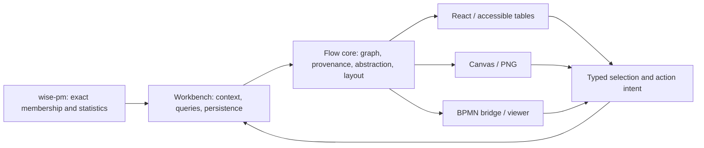

# Architecture

## 1. Layers

```
┌────────────────────────────────────────────────────────────┐
│ react/   <ProcessMap/> <TableAlternative/> <TraceTimeline/> │
│          <BpmnView/> <ViewSwitcher/> <ContextMenu/>          │
│          <PathList/> <FilterChips/> <CanvasMap/>             │
│          <VariantStrip/> <PerformanceSpectrum/> <DottedChart/>│
│          (0.4)                                               │
│          hooks: useFlowGraph, useStableLayout, useOverlays   │
├──────────────────────────┬─────────────────────────────────┤
│ canvas/  scene · draw ·  │ bpmn/  lite · layout · export ·   │
│          renderer · png  │        import · mapping · moddle  │
├──────────────────────────┴─────────────────────────────────┤
│ core/    model · aggregate · layout · style · overlays ·    │
│          views · hit · export · format · strings ·          │
│          selection · actions · paths · filters · lanes      │
└────────────────────────────────────────────────────────────┘
```

Dependencies point downwards only. `core` has no DOM and no React; it is
tested in Node. Renderers translate the core's scene description into
React Flow elements, Canvas draw calls or bpmn-js overlays.

## 2. Core

### 2.1 Model
`FlowGraph { nodes, edges, groups, overlays, meta }`, the JSON of
`GET /runs/{id}/flow`. Nodes: `activity`, `stage`, `gateway` (xor/and/or by
tag), `event` (start/end by tag), `note`. Node ids are the caller's stable
ids (canonical activity ids in the workbench). Edges: `follows`
(directly-follows with `count`, `cases`, `share`, `medianLagHours`,
`violationShare`), `constraint` (arc between two nodes with a payload),
`flow` (BPMN sequence flow). Groups: `lane`, `stage`, `pool`, nested through
`parent`. Every element carries a `metrics` record (numbers) and `tags`
(strings) that scales and overlays read. `validateGraph` reports duplicate
ids, dangling edges and unknown targets.

### 2.2 Aggregation
`abstract(graph, { minEdgeShare, minNodeShare, keepConnected, collapse })`
removes activities and follows edges whose strength (count or cases
relative to the strongest element) is below the thresholds, collapses stage
groups into stage nodes (semantic zoom) and restores connectivity: first a
maximum spanning forest over the strongest direct edges between the kept
nodes, then the cheapest paths of the original graph through removed nodes,
then one edge per activity that lost all incoming or all outgoing paths.
Re-added elements are tagged `reconnected` and drawn dashed. The thresholded
part is monotone in the thresholds; the reconnection is bounded (paths
between components plus one edge per open need) but not a global optimum,
so the total element count may differ by one re-added edge between
neighbouring thresholds. `diff(a, b)` returns a graph with `b`'s metrics,
`a_<metric>` and `delta_<metric>`, one-sided elements tagged.

### 2.3 Layout
`layout(graph, options)` runs ELK layered: in a Web Worker when the
application passes `elkWorkerUrl` (the URL of `elkjs/lib/elk-worker.min.js`),
in-process otherwise (Node, tests). Stage groups become compound nodes with
their order along the flow direction enforced through ELK partitions; lanes
are compound nodes as well. Dagre is the fallback on failure or timeout.
Elements are sorted by id before the engine runs, so positions are
deterministic. `Positions` holds absolute boxes for nodes and groups, edge
routes, bounds, engine and direction. **Stable layout**: `layoutUnion(scenes)`
lays out the union graph once and returns positions that every scene
filters (`filterPositions`), so compared maps do not jump. **Cache**: the
layout module owns it. A caller key (`cacheKey`) keeps positions in a shared
cache until its owner forgets the key. Without one, a layout scope
(`createLayoutScope`) keys each layout by its inputs (nodes with resolved
sizes, edges, groups, options), keeps a bounded number and releases them on
`dispose`, so a changed graph is always laid out anew. The module starts ELK
workers on demand and terminates each once no scope and no running layout
uses it. The map lays out the *abstracted* graph (not the full
directly-follows graph), because hundreds of weak edges degrade layered
layouts; each map's scope makes returning to a previous abstraction level free.

### 2.4 Style
`buildScales` builds d3 scales from metric ranges: edge width ← count
(square root), edge and node colour ← a chosen metric (expectation shortfall
share, performance, delta) on colour-blind-safe sequential (single hue),
diverging (purple–orange) and categorical (Okabe–Ito) palettes; categorical
keys hash to a stable colour with a pattern twin; text on coloured fills
uses an ink with contrast ≥ 4.5 : 1. Level-of-detail rules say from which
zoom labels, edge labels, badges, arcs, chips, hatching and self-loops
appear; thresholds tighten with the number of nodes. Colours, palettes, the
font stack, default node sizes, mark sizes, the arrowhead rule and the
pattern twins live in one token table (`tokens.ts`). The SVG export and the
marks read it, the Canvas renderer starts from it and follows the live CSS
variables, and `tokens.css` writes its themeable part as CSS variables,
checked against the table by a tooling test; the stylesheet reads the node
sizes through those variables.

### 2.5 Overlays
An overlay is data, not drawing: `{ kind, target, payload }` where kind is
`badge | arc | hatch | tint | chip | selfLoop` and target is a node, edge,
group id or `__map`. Presets map a constraint description (presence,
singularity, exclusion, lag, precedence, balance / metric, applicability)
and its statistics to overlays with formatted readings. Renderers draw
overlays; the core computes their geometry (badge slots along the node's
top edge, cubic arcs above the map and reverse arcs below it, self-loops at
the corner, chips inside groups) within a declared margin around the
layout, and their visibility by zoom level. Overlays are drawn in a
canonical order so that exports do not depend on input order. The scene
carries one resolved mark per placed overlay (box or path, fill, stroke,
dash, arrowhead, texts, layer, zoom threshold, whether it is drawn on the
map); one mapping turns a mark into SVG elements, which the SVG export
writes and the React map and the BPMN view create in the DOM, and the Canvas
drawing maps the same primitives to 2D calls. Nodes and edges have marks
too: a node's outline, fill, border, colour band and texts (label or glyph,
count, activity lines) with the level of detail each text is drawn from, an
edge's route (straight between the boxes where none is given), colour, dash
and count label at one label point. Node and edge texts are shortened by one
rule (`truncateText`) with a text measure the renderer injects; SVG, Canvas
and the React Flow map draw these marks.

### 2.6 Hit-testing and export
An R-tree (rbush) over nodes, groups, edge segments and overlay shapes for
hover and click on Canvas and in exports. `buildScene` resolves graph,
positions and options once into the scene renderers read (activity
references, lane bands, scales, the overlays to show with the follows
self-loops in canonical order, level-of-detail rules, overlay geometry,
overlay, node and edge marks, and the legend: the scales in use, the
overlay kinds present and the map-level chips);
`toSVG(scene)` draws it with figure presets
(single column, double column, slide), an embedded legend with the scales
and overlay glyphs, deterministic output. `toPNG` (in `canvas/`) draws the
same scene, presets and legend into a bitmap. The legend's rows and their
heights (`legendLayout`) and the figure frame (`figureFrame`: header, map,
legend column, activity key, output size) are measured once in the core;
both exports and `<Legend/>` list the same rows.

## 3. React renderer
`ProcessMap` reads the core scene (`buildScene`) through one hook: positions
restricted to the shown graph, lanes, manual moves, overlays, scales,
level-of-detail rules and geometry; in Canvas mode the same scene becomes the
Canvas map's retained geometry. Thin mapping to React Flow nodes and edges
with custom components per node and edge kind that draw the scene's node
and edge marks; groups as parent nodes;
the scene's overlay marks drawn by the node and group components that carry
them (badges, hatching, chips at their boxes, each from its zoom; tints as
background layers) and by an SVG layer in the viewport (arcs, self-loops);
edge labels and node details toggled through level-of-detail classes on the
container. Abstraction controls (activities, paths, stage
view, keep connected, table view) in a panel; the legend always visible.
Keyboard navigation over activities (arrow keys; Alt with an arrow key
along the paths; Space selects; Enter opens the actions menu; Shift with
an arrow key extends the selection; Escape; Home, End) with
`aria-activedescendant`, all transitions of the core's map controller
(§2.8); ARIA labels on every element, a hidden
description of the map and a polite live region that announces the
selection, the menu and the result of every action; `TableAlternative`
lists the same activities, paths and overlays as rows. Reduced motion is
respected. The actions menu (`ContextMenu`, `role="menu"`, accelerator
letters, focus returned to the map) opens on a right click or Enter; a
focus shows the paths of an activity with `PathList` at the side (the map
area shrinks and is fitted again); `FilterChips` sit above the map;
`lanes` draws bands instead of group boxes.

### 2.8 Interaction model (0.3)
The interaction state is data in the core so that the React renderer, the
Canvas renderer, the table alternative and the tests share one model.
`selection.ts`: a `Selection` of node, edge and group ids and the
transitions a click or a key makes (`replace`, `toggle`, `add`, `remove`;
groups alone; a pair or a set of activities), what stays bright for a
selection, and the sentence a live region announces. `actions.ts`: the
target of a menu (the element, or the pair or set it belongs to) and the
default actions per target in the order filter, explore, compare, author,
with accelerator letters and the filter clause every filter action adds;
the host fills or replaces them. `paths.ts`: incoming and outgoing paths
of an activity or a stage from the response's `paths` block or from the
map, the shortest-then-strongest path between two activities with its
reverse, and the sets a renderer highlights for a focus. `filters.ts`:
the workbench's filter clauses as typed data, their canonical form (so
that two orderings of the same clauses are byte-identical), plain-word
descriptions for chips, and the clause a map action produces; the map
never filters data, it calls back. `lanes.ts`: stage groups as ordered
bands along the flow (the ELK partitioning already orders them; the bands
are cut half-way between neighbouring stages and nodes do not move) or
lane groups as bands stacked across the flow with the nodes moved into
their lane. The lane model (which groups are lanes, the lane of every node,
stacking, the boxes of pools and parent lanes, and whether edges across
lanes are dropped or routed) is shared with `layoutBpmn`.
`map-controller.ts`: the transitions themselves. `mapStep(state, event,
context)` takes the interaction state (selection, focus of paths,
abstraction, view, the element the keyboard is on, hover, the open actions
menu) and a click, key, hover, focus or menu event, and returns the next
state, the sentence for the live region and the intents for the host
(callbacks, bringing a node into view, finding an element on screen for the
menu). The keyboard routes of §3 are its key transitions. Because the step
that opens a menu, runs an action or changes the selection also produces
its sentence, the live region does not depend on the order in which a
renderer applies state. `ProcessMap` feeds its events to it and draws its
state; each of `selection`, `focus`, `abstraction` and `view` is taken from
the prop when given and kept by the map otherwise.

### 2.7 Views
`buildViews(graph, views)` lays the base graph out once and resolves named
views on it: every view carries its own metrics (merged over the base by
id), overlays and style. The domain of a metric on a channel is computed
over all views, so the same colour or width means the same number in
Finance, Logistics, Compliance and Automation alike; the filled-in domains
are returned with each view's style. `<ViewSwitcher/>` renders the views
as tabs or as small multiples with a shared selection.

## 4. Canvas renderer (0.3)
`prepareScene` builds on the core scene (graph, positions, scales,
overlays, lane bands, level of detail, overlay geometry and marks) and adds
retained geometry with the R-tree of the core; `drawScene` issues plain 2D
context calls for a viewport (groups and bands, edges with arrowheads, nodes
with pattern twins, the overlay marks, edge labels), decides the level of
detail from the zoom and, above 1,500 elements, draws only what the R-tree
finds inside the viewport; `CanvasRenderer` owns the canvas, the viewport and the
interaction state and redraws on animation frames; `CanvasMap` adds the
pointer handling (drag to pan, wheel, Ctrl or Cmd with the wheel and pinch
to zoom, hover through the R-tree with a tooltip, click, right click), a
hidden element list for assistive technology and the zoom buttons.
`ProcessMap` switches to it above `canvasThreshold` (2,000 activities
plus paths) or on `renderer="canvas"` and keeps the selection, the menu,
the keyboard routes, the controls and the legend. `toPNG` draws a scene
with the same routines into an offscreen canvas in the figure frame and
with the legend of `toSVG`.

## 5. BPMN bridge (0.2)
BPMN-lite is BPMN in the core's own vocabulary: activity nodes tagged
`task`, gateway nodes tagged `xor` / `and` and `split` / `join`, event
nodes tagged `start` / `end`, `flow` edges, `lane` groups. Two builders
produce it: `liteFromStages` from an ordered stage model with known
activities (gateways only where the model needs them: XOR around optional
activities and stages and `choice` stages, AND around `parallel` stages)
and `liteFromGraph` from a directly-follows graph above an abstraction
level (XOR split where a node has several successors, XOR join where it
has several predecessors, AND on request where the successors follow each
other in both orders, loop markers for self-loops, start and end events
kept or added, groups as lanes). Ids are deterministic functions of the
input ids, so a rebuilt model keeps its ids. `<ProcessMap/>` renders
BPMN-lite natively when the full modeler is not wanted.

`layoutBpmn` uses ELK for the layering along the flow and then stacks the
lanes as full-width bands in one pool with the core's lane model, assigns
rows inside each lane so that shapes do not overlap and routes sequence
flows orthogonally with the core's `routeSequenceFlows`.
`exportBpmn` writes BPMN 2.0 XML with the diagram interchange from these
positions, a collaboration with one participant when lanes exist, and the
`wise` extension (FlowGraph id, kind, tags, metrics) so that
`importBpmn` restores the graph without loss; `validateBpmn` re-parses the
output. `importBpmn` reads supported BPMN 2.0 elements (tasks of all types,
gateways, events, lanes, pools, expanded sub-processes as stages, sequence
and message flows, annotations), reads positions from the DI and returns
a task ↔ activity mapping table that `matchActivities` fills by id, label
and alias and `applyMapping` applies to the graph. One vocabulary table
(`vocabulary.ts`: event definitions, gateway types, event roles, loop
marker, default flow, generated gateways) is read by export and import.
The id resolver (`ids.ts`) converts between FlowGraph ids, BPMN ids and
activity ids from the id map that import and export build and the mapping;
it alone decides which ids name an element.

`<BpmnView/>` hosts bpmn-js (navigated viewer, or the modeler) loaded on
demand, and projects the scene's overlay marks through bpmn-js's overlays
service (boxes such as badges, tints, hatching and chips, as overlays that
follow their shapes) and an SVG layer of the canvas (paths: arcs and
self-loops), with the same SVG elements as the map. The view reaches bpmn-js
only through a viewer interface (`viewer.ts`: import and save, the element
registry's boxes, overlays, markers, the SVG layer, selection, hover, change,
command and viewport events, zoom, viewbox and resize). Its adapters are
bpmn-js (`bpmn-js.ts`) and, in the component tests, an in-memory viewer that
builds its registry from the diagram interchange of the XML. Where each mark
goes is a function of the marks and the registry's boxes (`projectMarks` in
`projection.ts`: an overlay on an element at an offset, shown from a zoom,
with a class and a marker, or a path in the layer with the elements a click
selects), tested in Node; which ids a selection or a hover reports is
`selectionOf` and `hoverOf` of the viewer module. The bridge's modules other
than the entry point load neither React nor bpmn-js eagerly, and Node tests
import them through `headless.ts`; the architecture check enforces both. The core scene
(`buildScene`) over the imported graph and the boxes of the element registry
orders the overlays, sets the level of detail and places them. Overlay
datasets are replaced without re-importing, so the diagram and the viewport
stay fixed; targets may be FlowGraph ids, BPMN ids or activity ids resolved
through the mapping by the id resolver. Selection and hover callbacks, from the
diagram and from the table alternative alike, report tasks, flows and lanes
in FlowGraph ids for constraint authoring; the modeler's changes are saved
and passed to `onChange`. The bpmn.io watermark stays.

## 6. Custom views
Trace timeline (events on a time axis per case, violated constraints marked
on the events, span annotations, alignment by an anchor activity, table
alternative) ships in 0.1. Variant strip (chevrons with frequency and a
metric), performance spectrum (segments between two activities over time,
classified by duration band) and dotted chart (events by case over time,
colour by a categorical) remain planned. See the ordered [roadmap](ROADMAP.md);
their proposed rendering policy is SVG for small data and Canvas for larger samples.

## 7. Quality
Vitest for the core (aggregation invariants on the fixture and on random
graphs, layout stability, overlay geometry, deterministic scales and
export, selection transitions, default actions, path computation,
canonical filters, lane bands, the canvas routines on a recording
context, the BPMN overlay projection) and for the components (jsdom; the BPMN
view on the in-memory viewer), Storybook for components with the
design tokens, Playwright screenshots of the stories plus keyboard, filter
and canvas checks, strict TypeScript, ESLint, Changesets for releases.


## 8. Contracts and CI direction

Keep the core, renderer adapters and host responsibilities separate. No service
split or second graph engine is required. The following diagram shows ownership,
not a claim that future context/variant contracts already exist.



Current collapse metadata preserves original activities in `collapsedMembers` and
original edge targets in `collapsedEdgeTargets`; keep/exclude uses those activity
IDs. Collapsed edge and pair filters that cannot express exact original semantics
are unavailable. Overlays remain separate observations after merging; their
values are not averaged into a fabricated statistic. Internal edges target the
containing stage and folded arcs become labeled chips. Existing metric aggregation
approximations are unchanged. Response focus and paths survive abstraction.

Each map lays out in its own layout scope, keyed by the layout module from layout
options, resolved dimensions and relevant graph structure, and released on
unmount. Explicit caller cache keys remain caller-owned and must be invalidated by
their owner.
Timeline transient state is reconciled when cases/events change; unusable dates
remain available in the table without being placed at an invented time.

Next, add versioned context and metric provenance without breaking legacy inputs
(WF-02), then exact observed-variant exploration (WF-03). Keep exact case queries
and causal/action recommendations out of the renderers. Read the
[feature map](FEATURE_MAP.md) for current/partial/planned distinctions and
[CI contract](CI.md) for executable boundary and package checks.
