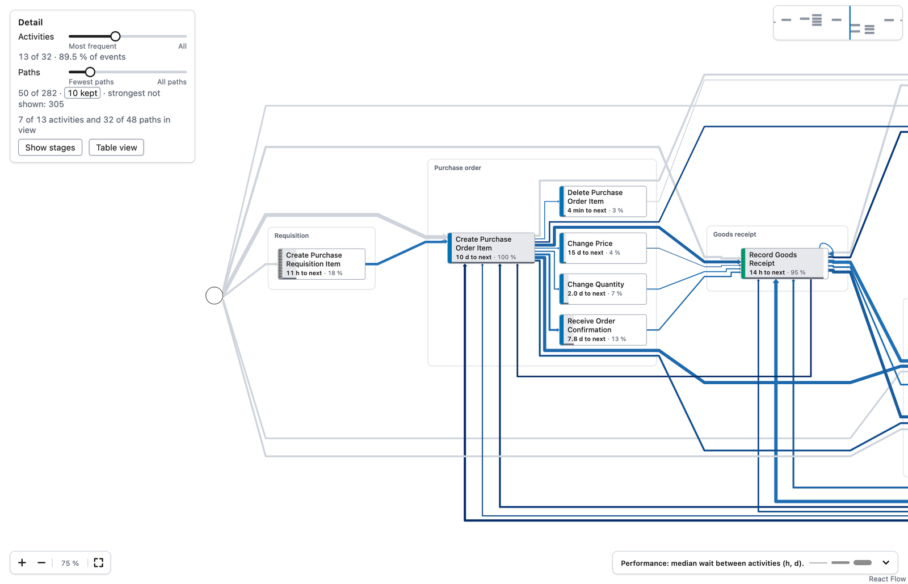
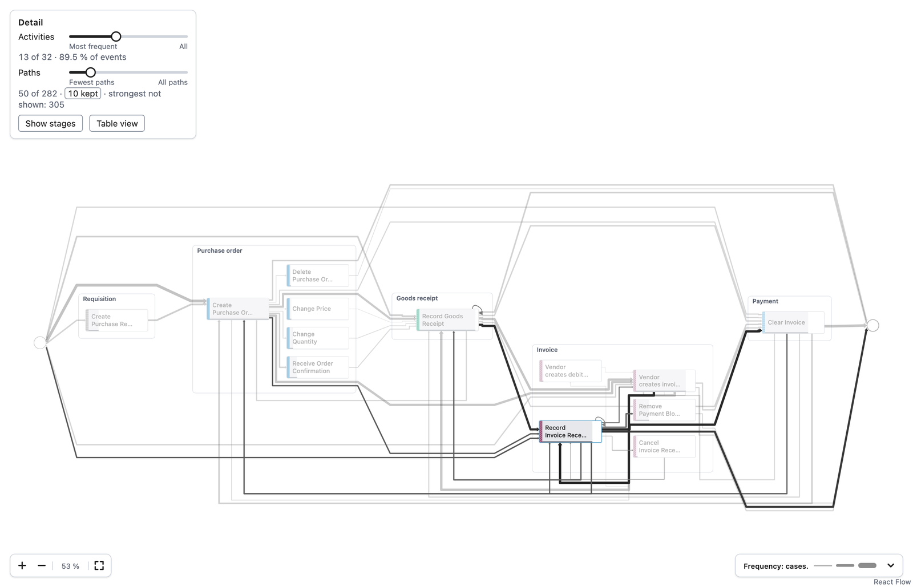
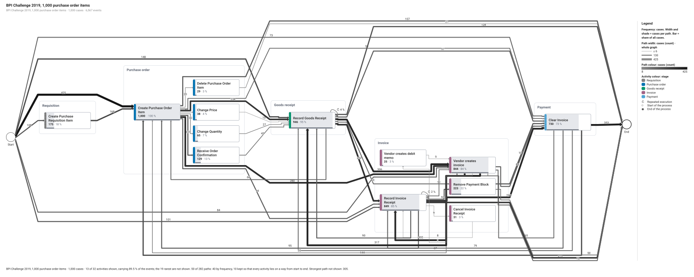
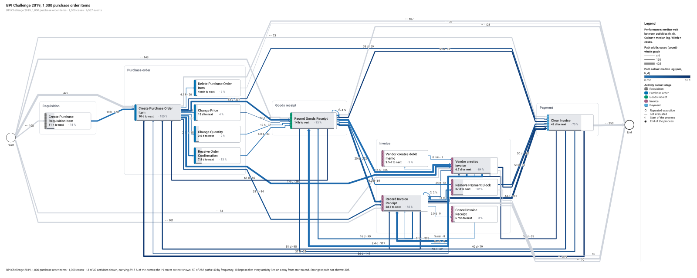

# From an event log to a map

wise-flow draws a process; it does not read event logs. The host counts what
happened in the log and hands the library a `FlowGraph`: the activities, the
paths between them and their numbers. This folder shows the whole way with the
purchase-to-pay log of the BPI Challenge 2019, in two small scripts that need
nothing but Node:

| File | What it does |
| --- | --- |
| [`csv-to-flowgraph.mjs`](csv-to-flowgraph.mjs) | Reads a CSV event log and writes the `FlowGraph` as JSON |
| [`bpic2019-stages.json`](bpic2019-stages.json) | Puts the BPIC 2019 activities into five purchase-to-pay stages |
| [`render-svg.mjs`](render-svg.mjs) | Draws a `FlowGraph` as an SVG figure, without a browser |

The pictures below come from a sample of the log: 1,000 purchase order items,
6,567 events, 32 activities and 282 paths.


## What the log needs

One row per event, with three columns:

- a **case**: what one run of the process is about (here a purchase order item);
- an **activity**: what happened ("Record Goods Receipt");
- a **time**: when it happened, as ISO 8601 or as logs usually write it
  (`2018-01-02 10:00:00+00:00`).

Other columns are ignored. The script reads the column names pm4py writes
(`case:concept:name`, `concept:name`, `time:timestamp`); `--case`,
`--activity` and `--timestamp` name others.

## 1. Count the log into a `FlowGraph`

```sh
node examples/event-log/csv-to-flowgraph.mjs BPI_Challenge_2019.csv \
  --stages examples/event-log/bpic2019-stages.json \
  --label "BPI Challenge 2019" --out bpic2019.json
```

It sorts each case's events by time (events at the same time keep the order of
the file) and counts:

| In the log | In the graph | Metrics the library reads |
| --- | --- | --- |
| each activity | a node, `kind: "activity"` | `events`, `cases`, `share` (of all cases), `starts`, `ends`; `medianNextHours` with `nextPassages` and `medianPrevHours` with `prevPassages` (the time to the next and from the previous event of the same case) |
| each pair of activities that follow each other in a case | an edge, `kind: "follows"`, id `source->target` | `count` (how often), `cases` (in how many cases), `share`, `medianLagHours`, `p90LagHours` and `lagPassages` (the wait between the two) |
| where cases begin and end | the nodes `__start` and `__end`, `kind: "event"`, tagged `start` and `end`, with an edge to each first and from each last activity | `cases`, `share` |
| the stage rules | `groups` of `kind: "stage"`, in process order; each activity names its stage in `group` | |

Ids are made from the names ("Record Goods Receipt" becomes
`record_goods_receipt`). A stage rule is a regular expression on the activity's
name; an activity belongs to the first rule in the file that matches it, and
the map draws the stages by their `order`. That is why the BPIC rules list
"Clear Invoice" (payment) before the broader "Invoice":

```json
{ "id": "payment", "label": "Payment", "order": 4, "match": "^Clear Invoice" }
```

The script reads the whole file into memory, which suits logs up to a few
hundred thousand events. For a larger log, count the same numbers where the log
lives (a database, pandas, pm4py) and write the same JSON;
[`fixtures/build_bpic2019_fixture.py`](../../fixtures/build_bpic2019_fixture.py)
does so with pandas for all 1.6 million events of the log, constraint
statistics included.

## 2. Show it in a React application

```tsx
import 'wise-flow/tokens.css';
import 'wise-flow/style.css';
import { useState } from 'react';
import type { AbstractOptions, FlowGraph, Measure } from 'wise-flow';
import { ProcessMap, type Selection } from 'wise-flow/react';
import elkWorkerUrl from 'wise-flow/elk-worker.min.js?url';
import graph from './bpic2019.json';

export function LogMap() {
  const [measure, setMeasure] = useState<Measure>('frequency');
  const [abstraction, setAbstraction] = useState<AbstractOptions>({ activityDetail: 0.4, pathDetail: 0.15 });
  const [selection, setSelection] = useState<Selection>({ nodes: [], edges: [], groups: [] });
  return (
    <div style={{ height: 700 }}>
      <ProcessMap
        graph={graph as FlowGraph}
        measure={measure} onMeasureChange={setMeasure}
        abstraction={abstraction} onAbstractionChange={setAbstraction}
        selection={selection} onSelect={setSelection}
        layout={{ elkWorkerUrl }}
      />
    </div>
  );
}
```

- **Detail.** `abstraction` sets how much of the graph the map shows: the most
  frequent activities (`activityDetail`, 0 to 1) and the most frequent paths
  between them (`pathDetail`). The panel's sliders change it, and the panel says
  what is shown ("13 of 32 · 89.5 % of events"; "50 of 282" paths). Paths that
  keep every shown activity on a way from start to end stay ("10 kept").
- **Opening.** By default the map opens readable: a large map opens at 75 % on
  the start of the process with an overview in a corner (below). `opening="fit"`
  shows the whole map at once (above), with shorter texts.
- **Measures.** With `onMeasureChange`, the legend offers frequency,
  performance and shortfall. Performance colours each path by its
  `medianLagHours` and writes each activity's `medianNextHours` ("10 d to
  next"); paths from the start and to the end have no wait and are drawn as
  not evaluated. Shortfall colours by `violationShare`, the share of cases
  through an element that miss an expectation: the host computes it from its
  own checks, which this example does not have.
- **Selection.** Clicking an activity selects it and dims what does not touch it
  (below, "Record Invoice Receipt").
- **Large logs.** With more than 2,000 activities and paths (`canvasThreshold`)
  the map draws on a canvas; pass the layout workers as the main
  [README](../../README.md#headless-example) shows, so the page stays responsive.





## 3. Draw a figure without a browser

```sh
npm run build   # in this repository; an application that installed wise-flow skips it
node examples/event-log/render-svg.mjs bpic2019.json \
  --measure performance --activities 0.4 --paths 0.15 \
  --theme default --preset slide --out map.svg
```

`render-svg.mjs` validates the graph, applies the detail with `abstract`, lays it
out with `layout` and writes the figure with `toSVG`: legend, title and a caption
that says how much of the graph is shown. `--theme print` (the default) draws
it for paper; `--preset single-column`, `double-column` or `slide` fit it to that
width.





## The data

The BPI Challenge 2019 log is public: B. F. van Dongen, *BPI Challenge 2019*,
4TU.ResearchData, [doi:10.4121/uuid:d06aff4b-79f0-45e6-8ec8-e19730c248f1](https://doi.org/10.4121/uuid:d06aff4b-79f0-45e6-8ec8-e19730c248f1),
licensed CC BY 4.0. Export it as CSV (or take any sample of it with the same
columns) to run the steps above; the log itself is not part of this repository.
The pictures were made with the commands shown, from a 1,000-item sample; the
three of the interactive map in Chromium at 1400 × 900.
